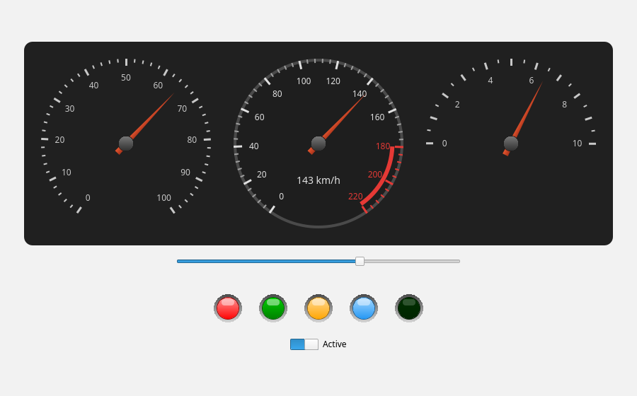
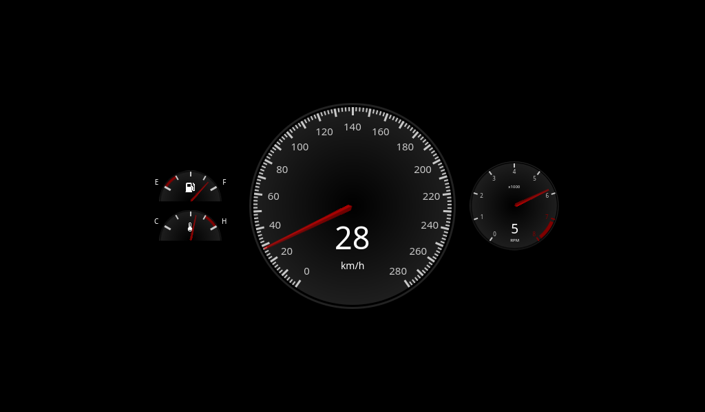
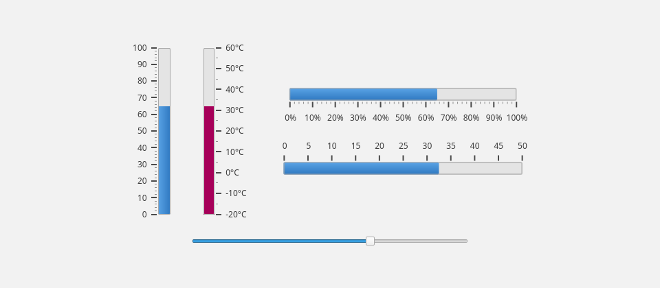
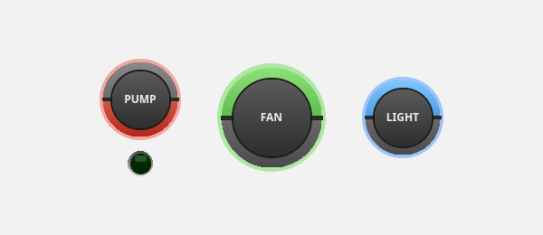

# Gaugebox

**Qt Quick Extras replacement for Qt 6** — circular gauges, linear gauges, status
indicators and toggle buttons for QML, API-compatible with Qt 5's `QtQuick.Extras 1.4`.

Qt 6 removed the Qt Quick Extras module, and with it `CircularGauge`, `Gauge`,
`StatusIndicator` and `ToggleButton`. Gaugebox brings them back, so porting a Qt 5
HMI to Qt 6 is a matter of changing the imports:

```qml
// Qt 5
import QtQuick.Extras 1.4
import QtQuick.Controls.Styles 1.4

// Qt 6
import Gaugebox
```

Your existing `style: CircularGaugeStyle { ... }` code keeps working — the style
properties, delegates and `styleData` are the same.



## Proof: the official Qt 5 Dashboard example, running on Qt 6

The Qt 5.15 *Dashboard* example (custom Canvas-drawn gauge styles, warning zones,
icons) runs on Qt 6 with only the import lines changed.
See [`examples/dashboard`](examples/dashboard) for the exact diff.



## Components

| Type | Style type | Notes |
|---|---|---|
| `CircularGauge` | `CircularGaugeStyle` | needle gauge: speedometers, manometers, dials |
| `Gauge` | `GaugeStyle` | linear gauge, vertical or horizontal: tanks, thermometers, load bars |
| `StatusIndicator` | `StatusIndicatorStyle` | indicator lamp |
| `ToggleButton` | `ToggleButtonStyle` | latching button with checked / unchecked indicators |

`Dial`, `DelayButton` and `Tumbler` are not included — they already exist in Qt 6's
`QtQuick.Controls`.





## Requirements

- Qt 6.8 or newer
- Uses only LGPL-licensed Qt modules: Qt Quick, Qt Quick Shapes, Qt Quick Templates.
  No Qt Charts, Qt Graphs or other GPL/commercial-only add-ons.
- Pure QML: works from C++ and from Python (PySide6 / PyQt6).

## Usage

Add the library to your CMake project:

```cmake
add_subdirectory(gaugebox/src/Gaugebox)

target_link_libraries(myapp PRIVATE gaugebox gaugeboxplugin)
```

```cpp
#include <QtQml/qqmlextensionplugin.h>
Q_IMPORT_QML_PLUGIN(GaugeboxPlugin)
```

```qml
import QtQuick
import Gaugebox

CircularGauge {
    width: 240
    height: 240
    maximumValue: 220
    value: vehicle.speed
}
```

## Differences from Qt 5

- `value` is clamped for display, but reading it back returns the value you set
  (clamping on write would break your property bindings).
- `ToggleButton` is based on `QtQuick.Templates.AbstractButton`; the Controls 1 extras
  `iconSource`, `menu`, `tooltip`, `isDefault` and `action` are not available.
- `PieMenu` and `Picture` are not included yet.

Full API notes: [`docs/API.md`](docs/API.md) (in Russian for now).

## Build the gallery

```sh
cmake -S . -B build
cmake --build build
./build/gallery/gaugebox_gallery
./build/examples/dashboard/dashboard_example
```

## License

Gaugebox is dual-licensed:

- **GPL-3.0-only** — free for open-source projects whose code is published under the
  GPL. See [`LICENSE`](LICENSE).
- **Commercial license** — for closed-source products. No obligation to publish your
  source code. See [`COMMERCIAL.md`](COMMERCIAL.md).

The `examples/dashboard` directory contains code from the Qt 5 examples and keeps its
original BSD license.

## Contributing

Bug reports and feature requests are welcome in Issues. Pull requests cannot be
accepted at this time — see [`CONTRIBUTING.md`](CONTRIBUTING.md).

Qt is a registered trademark of The Qt Company Ltd. Gaugebox is an independent
project and is not affiliated with The Qt Company.
